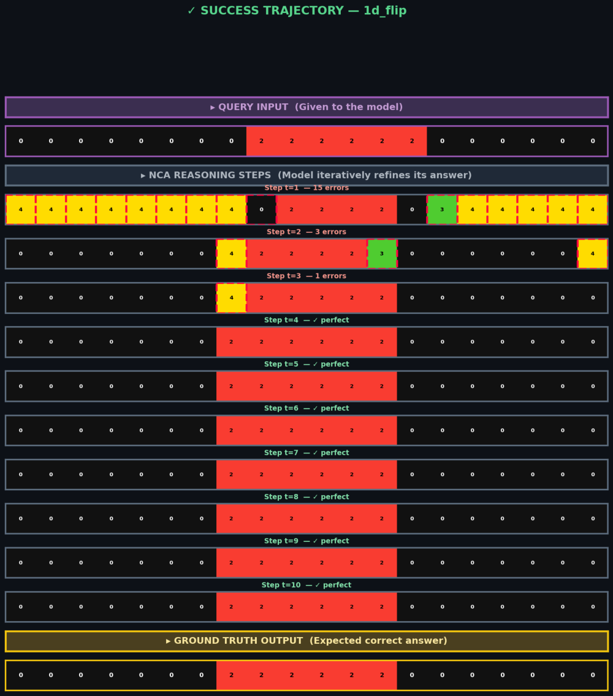
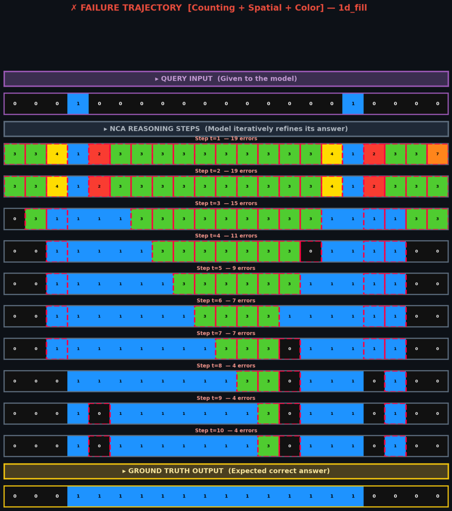
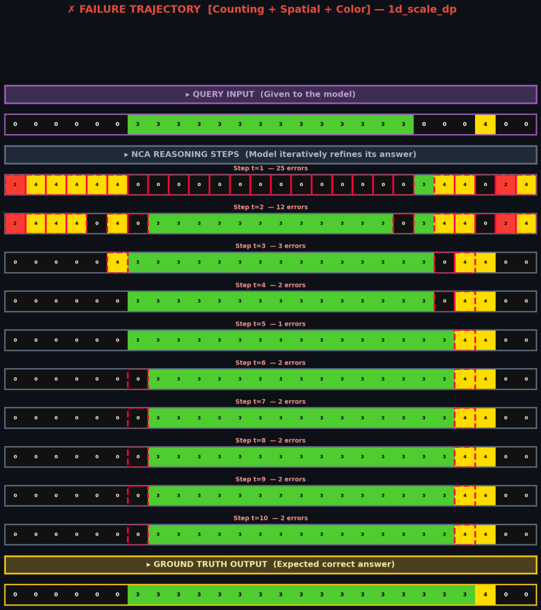

# Meta-NCA for 1D-ARC

Few-shot abstract reasoning on the **1D Abstraction and Reasoning Corpus (1D-ARC)** with a **Meta-Neural Cellular Automaton**. The model is written in PyTorch and runs fully offline, with no LLMs.

Each 1D-ARC task gives two or three input→output pairs of 1D colour sequences, and the model must produce the output for a new query input. This project encodes the example pairs into a *rule vector*. A **hypernetwork** turns that vector into the weights of a task-specific 1D convolution, and a **neural cellular automaton (NCA)** applies that convolution to the query for 10 steps. Before any of this, each task's colours are relabelled with abstract role IDs, so the model is not tied to a particular palette.

> **Context:** course assignment for *Meta & Transfer Learning* (1D-ARC assignment). The brief required a solution that runs fully offline, with no calls to large language models or other external services.

## Key results

Accuracy is exact-match per task: a task counts as solved only if every non-padding cell of the predicted query output is correct.

- **Same-concept**: the 75 held-out tasks from the 15 training concepts.
- **Cross-concept**: 151 tasks from 3 concepts that never appear in training (`1d_hollow`, `1d_recolor_cmp`, `1d_scale_dp`).

| Configuration | Same-concept | Cross-concept | Source |
|---|---|---|---|
| **Final model**: Meta-NCA + colour abstraction, d = 64 | **90.67%** (68/75) | **43.05%** (65/151) | Logged output of `notebooks/archive/meta_nca_final_run.ipynb`, the run that produced `checkpoints/best_abstract_nca.pth`; slides 1, 9, 13 |
| Same code, re-run | 89.33% | 43.71% | `notebooks/meta_nca_1d_arc.ipynb`, final cell |
| Exp 2: Meta-NCA + colour abstraction | 88.00% | 43.71% | `notebooks/meta_nca_1d_arc.ipynb`, Exp 2 cell (slide 9 lists 85.33% same-concept for this experiment) |
| Exp 1: raw Meta-NCA, no abstraction | 56.00% | 0.00% | `notebooks/meta_nca_1d_arc.ipynb`, Exp 1 cell |
| Exp 1: raw Meta-NCA, as reported in the slides | 58.67% | 12.58% | Slides 4, 5, 6, 9 (from a run that is not saved in the notebooks) |
| Exp 3: scaled Meta-NCA, d = 256 | 85.33% | 23.84% | Slide 9 only (the notebook's run of this cell stops at epoch 15) |

**Training curve of the final run** (from the notebook log, also shown on slide 10). Same-concept accuracy was:

- 65.33% at epoch 5
- 86.67% at epoch 15
- 88.00% at epoch 20
- 90.67% at epoch 40 (best checkpoint)
- 86.67% at epoch 100

**Model size.** The final model has 1,686,284 parameters (counted from the checkpoint tensors). Of these, 1,593,408 sit in the hypernetwork's output layer.

**LLM comparison.** Slide 4 compares these numbers with published LLM results on 1D-ARC: 12.5–17.0% for direct GPT-4 prompting and 30.0–37.5% for neuro-symbolic LLM pipelines. Read the [evaluation notes](#evaluation-notes) before comparing the two.

### Example trajectories

Each figure shows the query, the NCA state after each of the 10 steps (wrong cells outlined in red), and the target. The figures come from the presentation.

| Same-concept success (`1d_flip`) | Same-concept failure (`1d_fill`) | Cross-concept failure (`1d_scale_dp`) |
|---|---|---|
|  |  |  |

## Method

The final model is `MetaNCA` with `d_model = 64`. The pipeline has six stages.

1. **Task loading** (`RealARCDataset`). Each JSON task is one episode. The 2–3 support pairs are repeated to a fixed 30 pairs (`(train * 15)[:30]`). Every sequence is flattened, then padded with token `11` or truncated to 30 cells. The query is `test[0]`.
2. **Dynamic colour abstraction** (`apply_abstract_color_mapping`).
   - For each task, the distinct foreground colours in the support inputs are sorted and relabelled `1, 2, 3, …`.
   - Background (`0`) and padding (`11`) keep their IDs.
   - The same map is applied to the support outputs, the query input and the query target, so the model learns and predicts abstract IDs.
   - Colours that never occur in the support inputs are mapped to `0`.
3. **Support encoder**.
   - Each support input and output sequence goes through a 12 × 64 embedding. The two embeddings are concatenated per cell, giving 128 channels.
   - Two 1D convolutions (kernel size 3, 128→128→64) and a global max-pool reduce each pair to one vector.
   - Mean-pooling over the pairs (so their order does not matter) and a 2-layer MLP give the rule vector `z ∈ R^64`.
4. **Hypernetwork**. An MLP (64 → 128 → 12,352) maps `z` to the full weight tensor (64 × 64 × 3) and bias (64) of a `Conv1d` layer, so every task gets its own kernel.
5. **NCA engine**.
   - The query is embedded, with a separate embedding, into `H₀ ∈ R^{64×30}`.
   - It is updated residually: `H_{t+1} = H_t + ReLU(conv1d(H_t; θ(z)))`. A grouped convolution lets every task in the batch use its own generated kernel.
   - A linear head maps each cell to 12 logits.
6. **Training**.
   - Loss: cross-entropy on the abstracted query target, ignoring padding.
   - NCA steps: sampled uniformly from 8–12 per batch during training, fixed at 10 for evaluation.
   - Optimiser: Adam (lr 1e-3) with linear warm-up over 10 epochs (×0.1 → ×1) chained with exponential decay (γ = 0.95).
   - Other settings: gradient clipping at 1.0, batch size 16, 100 epochs.
   - Checkpointing: same-concept accuracy is measured every 5 epochs. The best checkpoint is saved and then scored once on cross-concept.

### Experiments in `notebooks/meta_nca_1d_arc.ipynb`

- **Exp 1, raw Meta-NCA**: the same architecture and training, with no colour abstraction.
- **Exp 2, + colour abstraction**: identical to the final pipeline apart from logging.
- **Exp 3, scaled**: d_model = 256, 30 NCA steps (25–35 during training) and 150 epochs. It also adds:
  - a 3-layer hypernetwork with LayerNorm and dropout 0.2
  - near-zero initialisation of the generated weights
  - 1/√d scaling of the generated weights
  - `tanh` updates instead of ReLU
- **Final pipeline**: the submitted configuration, the same as Exp 2.

The slides mention 12 architectures in total; the notebooks contain the four above.

Where the slides and the code disagree, this README follows the code:

- Slide 10 lists AdamW, cosine annealing with warm restarts and label smoothing. The code uses Adam with warm-up and exponential decay, and plain cross-entropy.
- Slides 5–6 rank colours by order of appearance. The code ranks them by sorted colour value.

## Evaluation notes

These points come from re-running the notebooks' preprocessing in plain Python over the included data. They are not part of the original submission, but they affect how the numbers above should be read.

- **Unseen colours collapse to background.** In 1D-ARC the query often uses a colour that no support input uses. The abstraction maps such colours to `0`, so the abstracted query and target can become entirely background.
  - This happens for 34/75 same-concept and 35/151 cross-concept queries. For those tasks, an all-background prediction is scored as correct.
  - Copying the abstracted query input unchanged would be scored as correct on 35/75 same-concept tasks (46.67%) and 69/151 cross-concept tasks (45.70%).
- **Sequences are truncated to 30 cells.** Sequences in the data are up to 93 cells long. 31/75 same-concept and 13/151 cross-concept queries are longer than 30 cells, and only their first 30 cells are scored.
- **Checkpoint selection uses the test split.** The same-concept figure is the best of 20 evaluations on the same-concept test split; there is no separate validation split.
- **Results vary between runs.** No random seed is set. Three runs of the same code gave 88.00–90.67% same-concept and 43.05–43.71% cross-concept.
- **LLM comparison.** Because of the points above, these scores are not directly comparable with published LLM results on the raw, full-length tasks.

Possible fixes:

- give unseen colours fresh IDs instead of `0`
- set `MAX_SEQ_LEN` to cover the longest sequence
- choose checkpoints on a validation split carved out of `train/`
- report an identity-copy baseline next to the model

## Dataset

The 1D-ARC tasks come from [khalil-research/1D-ARC](https://github.com/khalil-research/1D-ARC) (MIT License, © 2023 University of Toronto). The benchmark was introduced in Xu et al., 2023, *LLMs and the Abstraction and Reasoning Corpus: Successes, Failures, and the Importance of Object-based Representations* ([arXiv:2305.18354](https://arxiv.org/abs/2305.18354)).

A copy (about 3.5 MB, 901 tasks) is included in `data/1D-ARC/` together with the upstream `LICENSE.md`. It is re-split as follows:

| Split | Tasks | Concepts |
|---|---|---|
| `train/` | 675 | 15 concepts × 45 tasks |
| `test_same_concept/` | 75 | the same 15 concepts × 5 tasks |
| `test_cross_concept/` | 151 | `1d_hollow` (50), `1d_recolor_cmp` (50), `1d_scale_dp` (51) |

Files are named `<concept>_<concept>_<index>.json`. Each file holds a `train` list (the support pairs) and a `test` list (the query), each made of `{"input", "output"}` grids.

## Repository structure

```
.
├── notebooks/
│   ├── meta_nca_1d_arc.ipynb            # main notebook: Exp 1–3 + final pipeline, with logged outputs
│   └── archive/
│       └── meta_nca_final_run.ipynb     # earlier standalone final pipeline; its run gave the headline numbers
├── checkpoints/
│   └── best_abstract_nca.pth            # final model weights (state_dict, 6.4 MB)
├── data/
│   └── 1D-ARC/                          # train / test_same_concept / test_cross_concept + upstream LICENSE.md
├── docs/
│   ├── Meta-NCA_1D-ARC_presentation.pdf # 15-slide presentation
│   └── figures/                         # trajectory figures taken from the slides
├── requirements.txt
├── LICENSE
└── README.md
```

## Setup and reproduction

Use Python 3.10 (the notebooks were run on 3.10.20). The logged runs used a CUDA GPU, but the code falls back to CPU automatically.

```bash
git clone https://github.com/yashsinha1702/meta-nca-1d-arc.git
cd meta-nca-1d-arc
python -m venv .venv && source .venv/bin/activate
pip install -r requirements.txt
```

The data is already included in `data/1D-ARC/`. To start from a fresh copy, download the tasks from the [upstream repo](https://github.com/khalil-research/1D-ARC) and arrange them into the three split folders above.

**Train and evaluate.** The notebooks read data from `../data/1D-ARC/`, so launch Jupyter from `notebooks/`:

```bash
cd notebooks
jupyter notebook meta_nca_1d_arc.ipynb   # run the cells top to bottom
```

Each experiment cell does the following:

- trains for 100 epochs (150 for Exp 3)
- prints same-concept accuracy every 5 epochs
- finishes with the cross-concept evaluation

Each cell also saves its best checkpoint (for example `best_abstract_nca.pth`) into the working directory, so it never overwrites `checkpoints/`.

**Score the shipped checkpoint without retraining.** First define the classes and functions from the final cell, and build `test_cross_loader` as its `__main__` block does. Then run:

```python
model = MetaNCA(vocab_size=12, d_model=64, nca_steps=10, pad_idx=11).to(device)
model.load_state_dict(torch.load("../checkpoints/best_abstract_nca.pth", map_location=device, weights_only=True))
print(evaluate_tasks(model, test_cross_loader, device, pad_idx=11))
```

## License

The code is released under the [MIT License](LICENSE). The dataset in `data/1D-ARC/` keeps its own MIT license; see `data/1D-ARC/LICENSE.md`.
